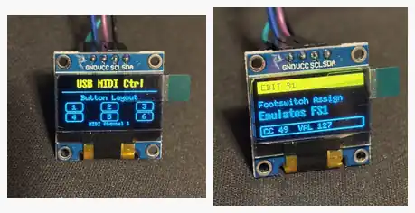

# KB2040 USB and DIN MIDI Controller for Line 6 HX Stomp

Firmware for a USB and DIN MIDI stompbox controller for the Line 6 HX Stomp,
built around an Adafruit KB2040. The controller sends MIDI CC messages for a
configurable set of one to six stomp switches, shows status on a 128x64 SSD1306 OLED, and
includes onboard controls for changing presets and switch assignments without
reflashing the firmware. A device-hosted web configurator provides full preset,
assignment-library, switch, and per-command MIDI-channel editing.

The controller supports two MIDI outputs with different intended uses. Use the
5-pin DIN MIDI output to control the HX Stomp directly. Use USB MIDI when
connecting the KB2040 to a USB host, such as a computer.

<p align="center">
  
</p>

> **Work in progress:** this project is currently undergoing hardware and
> firmware testing.

## Board Target

- Board: Adafruit KB2040
- Firmware framework: Arduino sketch using the Raspberry Pi Pico/RP2040/RP2350
  core by Earle F. Philhower, III
- FQBN: `rp2040:rp2040:adafruit_kb2040:flash=8388608_524288`
- USB stack: Pico SDK TinyUSB
- DIN MIDI output: KB2040 `D0` / GPIO0 / UART TX at `31250` baud

This is a KB2040/RP2040 project, not an Arduino-branded board. The firmware is
written as an Arduino `.ino` sketch and built with Arduino IDE or Arduino CLI
through the Philhower RP2040 board core.

The sketch pin numbers match the KB2040's RP2040 GPIO numbers for the digital
pins used here. For example, sketch pin `4` is GPIO4 / the board pad labeled
`D4`, not an AVR Pro Micro pin remap.

## Behavior

- Every Device Profile has its own MIDI channel from `1-16`, allowing one
  preset to control multiple MIDI devices without CC conflicts. Existing
  assignments inherit their preset's previous channel during migration.
- Each Device Profile can display Program Change values as either `0-127` or
  `1-128`; the raw MIDI Program Change byte remains `0-127`.
- USB MIDI is available for USB hosts such as computers.
- The HX Stomp does not act as a USB host for this controller, so direct HX
  Stomp control should use the 5-pin DIN MIDI output.
- Press debounce: `25 ms`
- Edit mode hold: `4 seconds`
- Assignments support fixed-value, toggle, and momentary MIDI CC behavior.
- Button presses use the configured output mode: USB and DIN, DIN only, or USB
  only. The default is USB and DIN.
- The last-button display returns home after a configurable `1-30` seconds;
  the default is `5 seconds`.
- The OLED home screen shows the active preset name and a compact map of each
  switch's current assignment.
- Hold-to-edit is globally configurable and defaults to off. When enabled,
  holding a stomp switch enters edit mode after the normal MIDI message has
  already been sent without waiting for the hold timer.
- Pressing the same stomp switch while editing exits edit mode.
- Turning the rotary encoder scrolls the assignment library while editing a
  stomp switch.
- In performance mode, encoder rotation and short presses do nothing. Holding
  the encoder for about `800 ms` opens the onboard menu, preventing accidental
  preset changes or configuration entry during a performance.
- While editing a stomp switch, a short encoder press exits edit mode.
- Up to `8` named pedal presets can be stored. Each preset has a default MIDI
  channel for new assignments, its own assignment library, and configurable
  switch mappings.
- One preset page toggle can reserve a stomp switch to flip between two selected
  presets while performing. The toggle changes the active page in RAM and sends
  no MIDI.
- Web Config macros can group multiple Device Profile commands into a reusable
  ordered sequence, with an optional delay after each step. A stomp switch can
  target either a single command or a macro.
- Device Profiles support up to `40` commands and no longer depend on the
  source spreadsheet. Commands can be inserted, removed, renamed, and configured
  as MIDI CC or Program Change messages in the browser.
- Configuration is versioned, checksummed, and saved atomically in a 512 KB
  LittleFS flash partition. Existing single-configuration EEPROM data is
  migrated into the initial HX Stomp preset on first boot.

## Onboard Menu

The menu controls are configurable. In encoder mode, hold the encoder for about
`800 ms` from the home screen to open the menu, rotate to move, short-press to
select, and hold to go back one level. In two-button mode, hold `Next` to open
or select, short-press `Previous` / `Next` to scroll, and hold `Previous` to go
back. The menu returns home after `10 seconds` without input. Stomp switch MIDI
output is suppressed while the menu is open.

The menu provides:

- Preset selection
- Preset page toggle setup under `Presets > Page Toggle`, including enable or
  disable, primary preset, alternate preset, and the reserved toggle switch
- Macro setup under `Macros`, including ordered command steps and per-step delay
- Assignment selection for all configured stomp switches, up to six
- Global hold-to-edit enable or disable
- MIDI output routing: USB and DIN, DIN only, or USB only
- Return-home delay for the last-button display
- System tools:
  - Web configuration startup
  - Reset current preset state, which clears live toggle state without sending MIDI
  - Software entry into firmware-update mode
  - Restore to default settings, with an additional confirmation step

## Web Configurator

The configurator follows the GP2040-CE model: configuration mode presents the
KB2040 as a USB network adapter and serves the web application directly from
firmware flash. It does not require Web MIDI, WebUSB, an internet connection,
or a browser extension.

Enter configuration mode using either intentional method:

1. Hold the configured menu entry control while powering or resetting the
   controller. Fresh firmware always checks `D1` as the universal recovery
   entry pin, so a temporary jumper from `D1` to `GND` can force web config
   even before menu controls have been customized.
2. Choose `Menu > System > Web Config > Start web config`.

There is no performance-mode hold shortcut directly to web configuration.

The OLED displays the configuration address:

```text
http://192.168.7.1
```

Open that address in a browser. Save & restart validates the complete
configuration, writes it to flash, and restarts the controller in normal MIDI
mode. The Presets tab can add, duplicate, rename, remove, and choose the active
preset. Import and export include all presets in one JSON configuration file.
The Device tab provides Light, Dark, and Black appearance modes; this preference
is applied immediately and stored locally by the browser. Device settings also
include hold-to-edit behavior, MIDI output routing, the return-home delay,
stomp switch count and pin mapping, and menu control mapping.

The Device tab also includes **Enter firmware update mode**. After confirmation,
the KB2040 restarts into its RP2040 ROM bootloader and appears as the `RPI-RP2`
USB drive, allowing a new UF2 build to be flashed without pressing the board's
BOOT and RESET buttons. The physical buttons remain the recovery method if the
running firmware cannot start or the web configurator is unavailable.

The initial USB-network implementation uses the RP2040 core's CDC-NCM network
class. Windows, macOS, and Linux enumeration must be verified on target systems
before treating cross-platform support as final.

## Button Wiring

Wire each button between the listed KB2040 board pad and `GND`. The firmware uses
`INPUT_PULLUP`, so a pressed button reads `LOW`.

| Button | KB2040 Board Pad / GPIO / Sketch Pin | Default assignment | MIDI value |
| --- | ---: | --- | ---: |
| 1 | D9 / GPIO9 / `9` | Previous Preset | CC72 value 63 |
| 2 | D8 / GPIO8 / `8` | Next Preset | CC72 value 127 |
| 3 | D7 / GPIO7 / `7` | Tuner On/Off | CC68 value 127 |
| 4 | D6 / GPIO6 / `6` | Snapshot 1 | CC69 value 0 |
| 5 | D5 / GPIO5 / `5` | Snapshot 2 | CC69 value 1 |
| 6 | D4 / GPIO4 / `4` | Snapshot 3 | CC69 value 2 |

## Menu Controls

The current test firmware can use two dedicated menu buttons, a GPIO rotary
encoder with push switch, or an Adafruit STEMMA QT I2C rotary encoder. The mode
and pins are set in the web configurator's Device tab.

### Two Buttons

Wire each menu button between its configured KB2040 pin and `GND`. The current
test wiring uses:

| Function | KB2040 Connection |
| --- | --- |
| Previous / back | `D10` / GPIO10 |
| Next / select | `A0` / GPIO26 |

### GPIO Rotary Encoder

The Previous and Next buttons are replaced by a Bourns
`PEC11R-4215F-S0024` rotary encoder with push switch. The firmware enables the
KB2040's internal pull-ups for all five signal terminals.

| Encoder Terminal | KB2040 Connection | Function |
| --- | --- | --- |
| A | `A1` / GPIO27 | Quadrature A |
| B | `A2` / GPIO28 | Quadrature B |
| C / Common | `GND` | Encoder common |
| Switch terminal 1 | `A3` / GPIO29 | Push switch input |
| Switch terminal 2 | `GND` | Push switch common |

If clockwise rotation moves backward, exchange the A and B connections. In
performance mode, rotation and short pushes are ignored; hold for approximately
`800 ms` to open the menu. Inside the menu, rotate to navigate, short-push to
select, and hold to go back. A short push still exits stomp-switch edit mode.

### STEMMA QT Rotary Encoder

The Adafruit I2C QT Rotary Encoder connects over the KB2040's STEMMA QT I2C bus
and uses one GPIO for the optional interrupt line.

| Encoder Breakout | KB2040 Connection | Function |
| --- | --- | --- |
| STEMMA QT | KB2040 STEMMA QT | `VIN`, `GND`, `SDA`, `SCL` |
| INT | `D10` / GPIO10 | Encoder activity interrupt |

When STEMMA QT mode is selected, the web configurator also reserves the GPIO
encoder A/B/switch pins so the loose encoder can remain a selectable future
mode without colliding with stomp switches.

## DIN MIDI Output Wiring

The DIN MIDI output mirrors the USB MIDI messages and is the intended connection
for the HX Stomp. This avoids the USB host limitation: the KB2040 presents
itself as a USB MIDI device, and the HX Stomp's USB port does not host that
device directly.

| DIN-5 MIDI Out Jack | KB2040 Connection |
| --- | --- |
| Pin 4 | Buck converter `5V OUT` through a `220 ohm` resistor |
| Pin 5 | `D0` through a `220 ohm` resistor |
| Pin 2 | `GND` / shield |
| Pins 1 and 3 | Not connected |

Be careful with DIN jack pin numbering: front view and solder-lug view are
mirrored. Verify pins with the connector datasheet or a continuity check before
soldering. Pins 4 and 5 above are the signal wiring used by the tested working
build. Pin 2 is the recommended transmitter-side cable-shield termination; the
controller was confirmed operational while pin 2 was still unconnected. The
same buck converter `5V OUT` also powers the KB2040 through `RAW`.

## Display Wiring

The sketch uses `Wire1`, the KB2040's secondary I2C bus on visible edge pins:

| I2C Signal | KB2040 Pin |
| --- | --- |
| SDA | D2 |
| SCL | D3 |

Use a 128x64 monochrome SSD1306 I2C display. The firmware uses U8g2 full-buffer
graphics mode for pixel-positioned text, frames, and inverse headers.

## Build

Install the Philhower RP2040 board package URL in Arduino IDE / Arduino CLI:

```text
https://github.com/earlephilhower/arduino-pico/releases/download/global/package_rp2040_index.json
```

Then compile with:

```powershell
powershell -ExecutionPolicy Bypass -File scripts/build.ps1
```

Equivalent Arduino CLI command:

```powershell
arduino-cli compile --fqbn rp2040:rp2040:adafruit_kb2040 KB2040MIDIController
```

Required libraries are `U8g2`, `MIDI Library`, and `ArduinoJson`. In Arduino
IDE, select **Adafruit KB2040** and set **Tools > USB Stack** to **Pico SDK**.

## Startup Screen

```text
MIDI Controller

Button Layout

1  2  3
4  5  6

MIDI Channel 1
```
